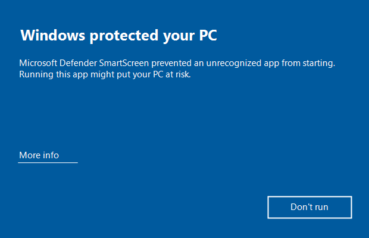
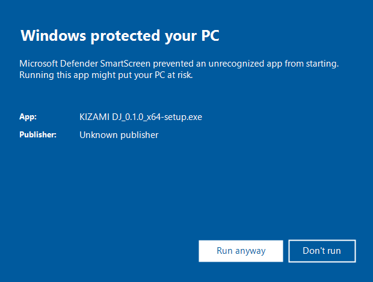

# Installing KIZAMI DJ (Windows)

The installer for KIZAMI DJ (free edition) is not code-signed, so Windows SmartScreen shows a warning. This page explains what you will see and how to check that the file has not been tampered with.

## Why it is not signed

- Code-signing certificates cost money every year.
- For a free edition, signing would not necessarily make the warning go away right away, so the cost is hard to justify.
- So the free edition is not signed. Instead, we publish its SHA-256 value so you can verify the file yourself.

## 1. Download

Download from: https://github.com/mugenphotog-art/kizami-dj/releases/latest

File name: `KIZAMI DJ_0.1.0_x64-setup.exe` (the name contains a space)

## 2. Verify the SHA-256 (recommended)

Compare the SHA-256 value on the download page with the value of the file you downloaded.

1. Open PowerShell (type "PowerShell" in the Start menu).
2. Run the following (assuming the file is in your Downloads folder):

```powershell
Get-FileHash -Algorithm SHA256 "$env:USERPROFILE\Downloads\KIZAMI DJ_0.1.0_x64-setup.exe"
```

3. If the `Hash` value matches the one on the download page, the file is intact (case does not matter).
4. If it does not match, do not install it. Delete the file and download it again. If it still does not match, please let us know on the Issues page (https://github.com/mugenphotog-art/kizami-dj/issues).


## 3. Open the installer (SmartScreen warning)

When you double-click `KIZAMI DJ_0.1.0_x64-setup.exe`, a blue window may say "**Windows protected your PC**". This appears because the installer is unsigned; it is not specific to this file.

1. Click **"More info"** in the window.
2. Click the **"Run anyway"** button that appears.

(The two images below are illustrations of the screens; details may differ slightly from what you see.)





If "Run anyway" does not appear, check again that the SHA-256 from step 2 matches.

## 4. Install

1. Follow the installer. No administrator rights are needed (it installs for the current user only).
2. When it finishes, start "KIZAMI DJ" from the Start menu.
3. On first launch, a license agreement screen appears. Read it and click **[Agree]** to use the app. If you click **[Decline]**, the app quits.

The installer follows the Windows display language; the screenshot below is from a Japanese Windows.


## 5. Where your data is, and uninstalling

- Settings and library data are stored in `%APPDATA%\KIZAMI DJ`, and recordings in `Documents\KIZAMI DJ\Recordings`.
- **Uninstalling does not delete this data.** Remove "KIZAMI DJ" from "Installed apps" in Windows Settings.
- Even if the uninstaller has a "Delete the application data" checkbox, it only removes `%APPDATA%\app.kizamidj.desktop` and `%LOCALAPPDATA%\app.kizamidj.desktop` (WebView2 internal data). Your library and settings (`%APPDATA%\KIZAMI DJ`) are not deleted.
- If you also want to remove the data, delete the folders above yourself.

## Troubleshooting

- If the app does not start or the warning does not go away, let us know on the Issues page (https://github.com/mugenphotog-art/kizami-dj/issues).
- If your antivirus software reacts, please send us the file name and the name and message of the software.
