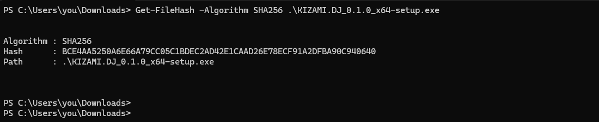
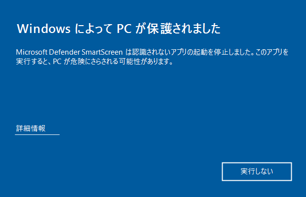
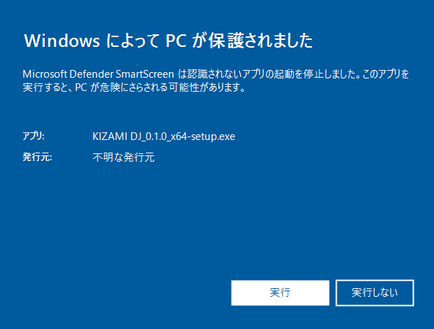
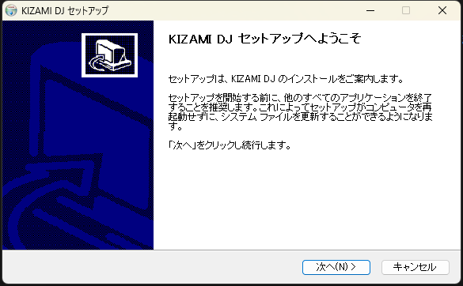
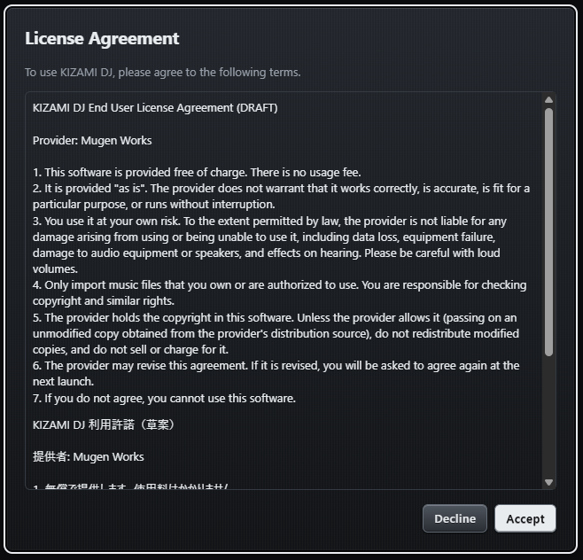

# KIZAMI DJ インストール手順（Windows）

KIZAMI DJ（無料版）のインストーラーは、コード署名をしていません。そのため、Windows の SmartScreen が警告を出します。このページでは、その画面の見方と、ファイルが改ざんされていないかの確かめ方を説明します。

## 署名をしていない理由

- コード署名の証明書には毎年の費用がかかります。
- 無料版では、署名しても警告がすぐに消えるとは限らないため、費用に見合いません。
- そこで無料版では署名せず、代わりに SHA-256 の値を公開して、ファイルを確かめられるようにしています。

## 1. ダウンロード

ダウンロード先: https://github.com/mugenphotog-art/kizami-dj/releases/latest

ファイル名: `KIZAMI DJ_0.1.0_x64-setup.exe`（名前に半角スペースが入ります）

## 2. SHA-256 を確かめる（おすすめ）

配布ページに載っている SHA-256 の値と、手元のファイルの値が同じか確かめます。

1. PowerShell を開きます（スタートメニューで「PowerShell」と入力）。
2. 次を実行します（ファイルをダウンロードフォルダに置いた場合）。

```powershell
Get-FileHash -Algorithm SHA256 "$env:USERPROFILE\Downloads\KIZAMI DJ_0.1.0_x64-setup.exe"
```

3. 表示された `Hash` の値が、配布ページの値と一致すれば問題ありません（大文字と小文字の違いは無視してかまいません）。
4. 一致しないときは、インストールせずにファイルを消して、もう一度ダウンロードしてください。それでも一致しないときは、Issues ページ（https://github.com/mugenphotog-art/kizami-dj/issues）へ知らせてください。



## 3. インストーラーを開く（SmartScreen の警告）

`KIZAMI DJ_0.1.0_x64-setup.exe` をダブルクリックすると、青い画面で「**Windows によって PC が保護されました**」と出ることがあります。署名がないための表示で、このインストーラーに限ったものではありません。

1. 画面の中の **「詳細情報」** を押します。
2. 下に出る **「実行」** を押します。

（以下の2枚は、画面の説明用のイラストです。実際の表示とは細部が異なることがあります。）





「実行」が出ないときは、手順 2 の SHA-256 が一致しているか、もう一度確かめてください。

## 4. インストール

1. インストーラーの案内に従って進めます。管理者権限は要りません（今のユーザーだけにインストールされます）。
2. 完了したら、スタートメニューの「KIZAMI DJ」から起動します。
3. 初めて起動すると「利用許諾」の画面が出ます。内容を読んで **[同意する]** を押すと使えます。**[同意しない]** を押すとアプリが終了します。





## 5. データの場所と削除

- 設定・ライブラリなどのデータは `%APPDATA%\KIZAMI DJ` に、録音は `ドキュメント\KIZAMI DJ\Recordings` に保存されます。
- **アンインストールしても、これらのデータは消えません。** 設定の「インストールされているアプリ」から「KIZAMI DJ」を削除してください。
- アンインストーラーに「アプリケーションデータを削除する」のチェックがあっても、消えるのは `%APPDATA%\app.kizamidj.desktop` と `%LOCALAPPDATA%\app.kizamidj.desktop`（WebView2 の内部データ）だけです。ライブラリと設定（`%APPDATA%\KIZAMI DJ`）は消えません。
- データも消したいときは、上のフォルダを自分で削除してください。

## 困ったとき

- 起動しない、警告が消えない、などは、Issues ページ（https://github.com/mugenphotog-art/kizami-dj/issues）へ知らせてください。
- ウイルス対策ソフトが反応した場合は、ファイル名と、ソフトの名前・表示された文言を添えて知らせてください。
